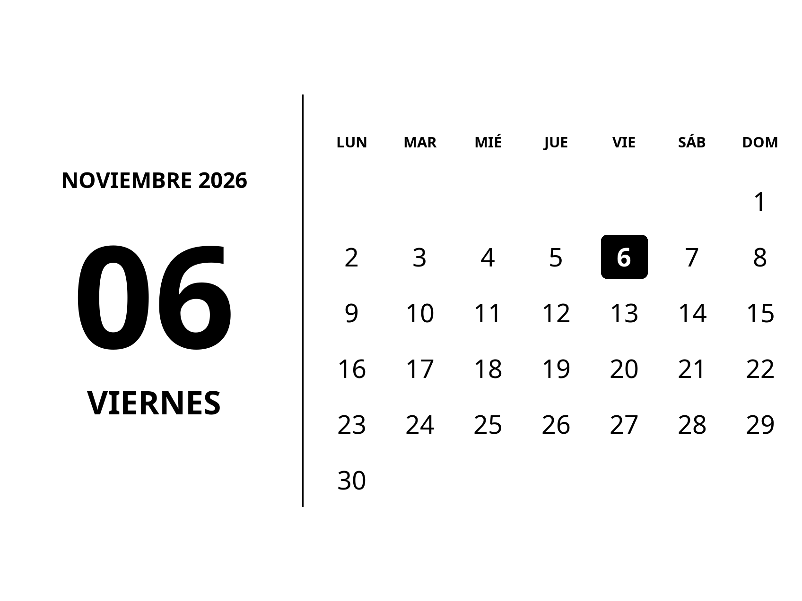

# Kindle Calendar Screensaver

Calendario mensual offline, en español, para Paperwhite 12 (PW6, 2024).
Prototipo **0.3.0** con diagnóstico ejecutado en el Kindle; integración de pantalla
de reposo y RTC pendiente de validación. No es todavía un screensaver funcional.

Véra declara soporte para PW6 con **5.20.1.0.2**. No se ha confirmado en este
proyecto que el conjunto pantalla + suspensión + RTC funcione en ese firmware.
Ver [investigación y fuentes](docs/feasibility.md).



## Ejecutar en una computadora

Python 3.9 o posterior con base de zonas horarias IANA; usar el checkout completo.
No se necesita Kindle, Wi-Fi del Kindle, Docker, KOReader ni ImageMagick.

```sh
python3 -m venv .venv
.venv/bin/python -m pip install -r requirements.txt
export PYTHONPATH="$PWD/src"
.venv/bin/python -m kindle_calendar generate --start 2026-11-06 --end 2027-12-31 --out build/images
.venv/bin/python -m kindle_calendar verify build/images
.venv/bin/python -m kindle_calendar plan --now 2026-12-31T23:59:59-03:00
.venv/bin/python tools/simulate.py
.venv/bin/python -m unittest discover -s tests -v
```

El diseño predeterminado es apaisado: fecha grande a la izquierda y calendario a
la derecha, con el botón de encendido del Kindle a la izquierda. El lienzo mide
1696 × 1272; se exporta una sola orientación, girada 270° en sentido horario, como
PNG nativo de 1272 × 1696. Usa grises de 8 bits y fecha ISO como nombre.
La carpeta de salida debe estar vacía. Se puede cambiar el tamaño con `--width`
y `--height`. El giro se realiza una sola vez en la computadora; no se necesita
elegir entre variantes al instalar. `--rotation` permite sobrescribirlo para
diagnóstico, pero el uso previsto es el predeterminado con botón a la izquierda.
El renderizador real aún debe comprobarse para evitar un segundo giro automático.
El manifiesto distingue tamaño de diseño, tamaño exportado y giro horario.
Las fuentes Noto Sans están incluidas con su licencia OFL.
La reproducibilidad de bytes se comprueba con el mismo Python/Pillow y fuentes;
no se promete identidad entre diferentes versiones de FreeType o zlib.

## Preparar y revertir un paquete local

```sh
export PYTHONPATH="$PWD/src"
.venv/bin/python -m kindle_calendar stage build/images --root build/staging
.venv/bin/python tools/package.py build/staging/kindle-calendar --out dist/kindle-calendar-disabled.zip
# Reversión del staging, sólo si no se modificó después:
.venv/bin/python -m kindle_calendar unstage --root build/staging
```

Esto escribe únicamente un directorio local y un ZIP desactivado. Rechaza rutas
de montaje habituales del Kindle y del sistema. No instala servicios ni cambia
el firmware. La desinstalación conserva un staging modificado para revisión.

## Estado y siguientes pasos

| Componente | Estado |
| --- | --- |
| Generador, manifiesto y verificación SHA-256 | Implementados y probados en computadora |
| Diagnóstico físico mediante KPM | Ejecutado; root, firmware, ABI y propiedades powerd confirmados |
| Vista previa manual de 25 segundos | Preparada y probada con simulación; ensayo físico pendiente |
| Ejecutor POSIX de una sola ejecución | Probado con reloj y backend simulados |
| Planificador | Modelo ejecutable; KindleCron es candidato externo |
| Backend de pantalla / puente de eventos | Pendiente de implementar tras observar el Kindle |
| Arranque automático y recuperación de pantalla | Diseño y protocolo de validación; no instalados |
| Actualización durante suspensión profunda | No verificada en PW6 / 5.20.1.0.2 |

Documentación: [viabilidad](docs/feasibility.md), [arquitectura](docs/architecture.md),
[instalación y reversión](docs/installation.md), [pruebas físicas](docs/hardware-validation.md)
y [resultados locales](docs/test-report.md).
La [validación física](docs/hardware-observations.md) distingue lo observado en el
Kindle de lo que todavía necesita ensayos.

No ejecutar jailbreak ni habilitar integración de energía sin autorización
explícita del propietario. No se incluyen exploits ni binarios descargados de
los proyectos de referencia. Licencia del código propio: MIT.
