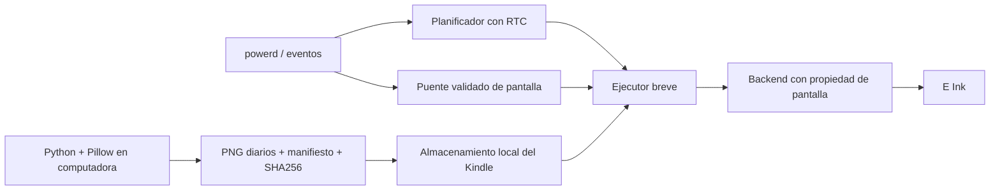

# Arquitectura

## Decisión

Precálculo en computadora + trabajo breve por eventos + suspensión administrada
por Amazon. Reutilizar KindleCron si supera la validación física; adaptar el manejo
de pantalla de Custom Screensaver sólo después de comprobarlo en esta unidad.
No crear un segundo propietario del RTC ni un bucle que consulte la hora.

El generador y el ejecutor están implementados. Puente, backend de hardware,
supervisión de arranque y adaptación de KindleCron son integración pendiente,
no capacidades implícitas del diagrama. El simulador sólo modela decisiones.

## Módulos y contratos

* `calendar.py`: calendario gregoriano lunes-domingo, cadenas españolas y próxima
  medianoche en `America/Argentina/Buenos_Aires`. Rechaza datetimes sin zona.
* `generator.py`: PNG `L` de 8 bits, fuentes locales con licencia, manifiesto con
  cobertura inclusiva, tamaño y checksums. Rechaza sobrescribir un bundle existente.
* `calendar-worker.sh`: proceso POSIX de una ejecución; elige la fecha real del
  reloj en cada llamada. Valida checksum, consulta estado, reintenta tres veces y
  registra la fecha sólo después de un render exitoso. No tiene red ni setters.
* Planificador externo: un trabajo diario a la medianoche local; guarda de
  suspensión durante el trabajo, timeout total de 60 s y programación del próximo
  despertar en la ventana correcta. No reimplementar RTC dentro del worker.
* `deployment.py`: instalación y desinstalación **de staging en computadora**,
  copia transaccional y validación antes de publicar. No configura el Kindle.
* `simulation.py`: modelo de eventos con reloj virtual y fallos inyectados.

Un backend se colocaría en `INSTALL_ROOT/backend`, como ejecutable con dos órdenes:

| Orden | Contrato obligatorio |
| --- | --- |
| `status` | Imprime exactamente `active` o `asleep`; error si no conoce el estado |
| `render PNG` | Recomprueba propiedad y desbloqueo bajo sincronización compartida; devuelve 0 sólo cuando terminó el refresco |

`asleep` significa que la integración posee la pantalla de reposo; no significa
que la CPU esté suspendida durante la ejecución. El proceso necesariamente corre
despierto. El backend debe coordinarse con el shield y renderer Amazon y respetar
el PIN. No basta leer una propiedad `state` y asumir que se puede dibujar.
El worker limita `status` a 5 s y `render` a 10 s por intento, con SIGKILL tras
1 s adicional si ignoran SIGTERM (`timeout -k`, que debe estar disponible).
No hay backend de
hardware incluido porque aún no se conoce ese contrato en el firmware objetivo.

El destino empieza con `DISABLED`; no quitarlo en el Kindle hasta completar las
pruebas y la aprobación. Se requiere `state/` escribible y `flock`, `timeout`,
`sha256sum`, `awk`, `date`, `mv` y shell POSIX comprobados en el dispositivo.
No ejecutar el worker como scriptlet visible en pantalla: puede dibujar stdout.

## Secuencia de integración prevista

1. Arranque: comprobar modelo, firmware y dependencias contra un perfil validado.
   Si difieren, no apagar renderizadores ni iniciar integración. Cargar servicios
   mediante mecanismo de arranque documentado por el jailbreak, aún por verificar.
2. Entrada a reposo: el puente toma propiedad de la pantalla, llama al worker con
   `sleep` y mantiene la posibilidad de restaurar renderizadores si falla.
3. `readyToSuspend`: sólo el planificador arma el próximo RTC y permite suspender.
4. Despertar RTC: adquirir guarda de suspensión, seleccionar fecha actual, refrescar
   si sigue en reposo, liberar guarda. Permitir a powerd volver a suspender solo.
5. Desbloqueo: cancelar render pendiente, retirar shield y devolver control a Amazon.
   Un job que cae mientras se lee no dibuja ni fuerza la suspensión del lector.
6. Cambios de reloj y eventos de recuperación: recalcular próxima medianoche y
   seleccionar la fecha actual; nunca incrementar un contador de días.

El orden entre el evento de reposo y el dibujo upstream requiere un hook
sincronizado; dos listeners independientes no garantizan ese orden. No se ofrece
una receta de copiar archivos y arrancar ambos daemons como si ya fuera correcta.

## Tiempo, almacenamiento y fallos

El host usa `zoneinfo`. En el worker `TZ=ART3` expresa UTC−3 sin horario estacional
con las reglas actuales de Buenos Aires. No es una base IANA ni cubre futuros
cambios legales. No modifica `/etc/localtime` ni el reloj del Kindle. El daemon
KindleCron usa `time.Local`: habrá que verificar su base IANA/entorno antes de
elegir su configuración de zona. No asumir que Go interpreta `ART3` como libc.

No usar `every 24h`: después de un cambio de reloj puede dejar de coincidir con
medianoche. La configuración diaria debe tener zona local validada y recalcular
en cada ciclo de suspensión. Los límites mínimos del RTC y el despertar anticipado
pueden afectar la precisión: medir latencia, no prometer exactitud al segundo.

Los PNG son inmutables; cada versión se copia a una carpeta distinta. El manifiesto
se escribe al final. Un bundle incompleto no pasa verificación. El lock es del
kernel, por lo que un reboot no deja un PID obsoleto. El archivo `displayed` se
reemplaza por rename y es sólo diagnóstico: no se usa como verdad de la pantalla.
No se promete persistencia ante pérdida eléctrica sin `fsync`; el siguiente
evento vuelve a calcular todo y reintenta. El panel podría conservar una imagen
parcial si falla un refresco: conservar la última confirmación no lo revierte.

Ante fecha sin imagen, checksum inválido o propiedad desconocida, el worker falla
sin dibujar. El futuro puente deberá restaurar el screensaver Amazon y registrar
el fallo sin otro despertar de reintento. Ante un reloj incorrecto no hay una
fuente mágica de fecha offline: corregir el reloj del sistema de forma consciente.

Logs limitados por tamaño y escrituras únicamente por eventos; nada de cron por
minuto. La supervisión será por eventos de salida del proceso, no polling.
Una caída abrupta requiere un supervisor capaz de restaurar renderizadores;
limpiar únicamente con `trap` no cubre SIGKILL. Eso se valida antes de autostart.

## Alternativas y extensibilidad

Un navegador o una aplicación permanentemente abierta no satisface el reposo.
Un proceso con `sleep 86400` no despierta una CPU suspendida. Desactivar suspensión
cumpliría el cambio visual a costa del requisito energético. Por eso se descartan.
Precálculo consume almacenamiento, pero elimina renderizado de fuentes en el
Kindle. El tamaño real se mide al generar, sin estimar autonomía desde el panel.

Módulos futuros pueden producir los PNG mediante una interfaz de render en la
computadora. En esta versión no hay clientes HTTP, credenciales, cron de descarga,
plugins opcionales cargados ni servicios de Google/tiempo instalados.
